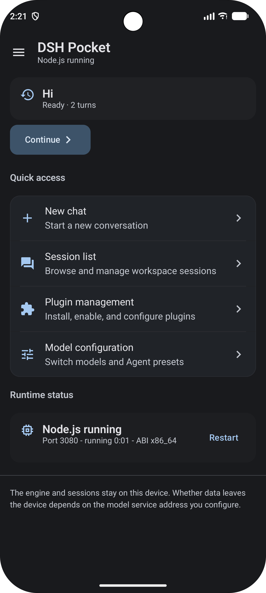
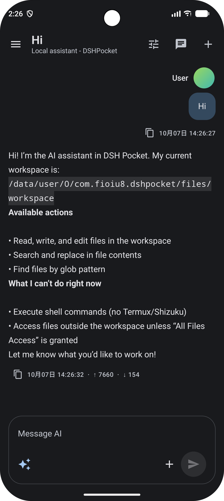
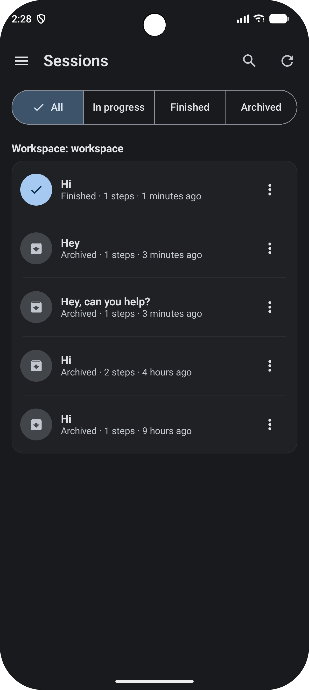
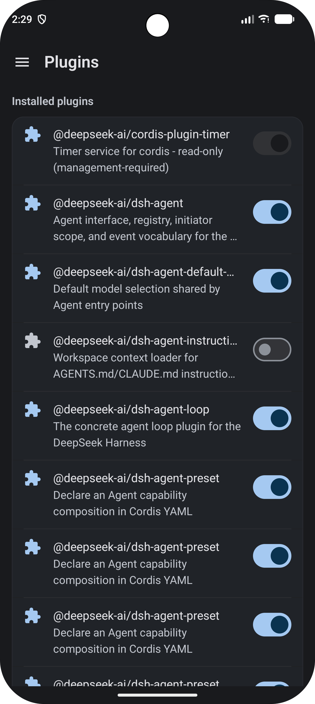

# DSH Pocket

**A native Android client for DeepSeek Harness.** DSH Pocket starts a Node.js runtime and the DSH web service on-device, with a native Compose chat interface and management screens.

[简体中文](README.zh-CN.md)

> DSH Pocket requires Android 7.0 (API 24) or later. It deliberately targets API 28 so its bundled runtime can execute from app-private storage. Distribution is currently intended for sideloading, not Google Play.

## Screenshots

| Home | Chat |
| --- | --- |
|  |  |

| Sessions | Plugins |
| --- | --- |
|  |  |

## Features

- Run the DSH Node.js agent engine locally on Android; the engine is managed by a foreground service.
- Switch between the native chat interface and the official DSH web interface; supports streaming responses, session browsing, archiving, and restoring.
- Configure model providers, inspect installed plugins, and manage runtime and capability settings.
- Optionally grant all-files access so the agent can read and write files in the shared `DSHPocket` workspace; the app-private workspace is used by default.

The engine and its web UI communicate over `127.0.0.1`. Prompts and related context may leave the device when sent to the model provider configured by the user. Filesystem access depends on the Android capability granted to the app and the selected workspace.

## Main dependencies

| Component | Version | License | Source / package repository |
| --- | --- | --- | --- |
| AndroidX Activity Compose | 1.13.0 | Apache-2.0 | [AndroidX](https://github.com/androidx/androidx), Google Maven |
| Jetpack Compose UI, Material 3, icons | Compose BOM 2026.02.01 | Apache-2.0 | [AndroidX](https://github.com/androidx/androidx), Google Maven |
| AndroidX Core KTX | 1.19.1 | Apache-2.0 | [AndroidX](https://github.com/androidx/androidx), Google Maven |
| AndroidX Lifecycle Runtime KTX | 2.11.0 | Apache-2.0 | [AndroidX](https://github.com/androidx/androidx), Google Maven |
| AndroidX WebKit | 1.14.0 | Apache-2.0 | [AndroidX](https://github.com/androidx/androidx), Google Maven |
| `@deepseek-ai/dsh` and its npm dependency tree | CI: 0.2.0-rc.2; release: selected by workflow | MIT and other upstream licenses | [DeepSeek Harness](https://github.com/deepseek-ai/deepseek-harness), [npm](https://www.npmjs.com/package/@deepseek-ai/dsh) |
| Node.js LTS (`nodejs-lts`) | Resolved from Termux index at build time | MIT | [Termux recipe](https://github.com/termux/termux-packages/blob/master/packages/nodejs-lts/build.sh) |
| C++ runtime (`libc++`) and OpenSSL | Resolved from Termux index at build time | NCSA; Apache-2.0 | [Termux packages](https://github.com/termux/termux-packages) |
| ICU (`libicu`) and Mozilla CA certificates | Resolved from Termux index at build time | Custom ICU license; MPL-2.0 | [Termux packages](https://github.com/termux/termux-packages), [ICU license](https://github.com/unicode-org/icu/blob/main/LICENSE) |
| `c-ares`, SQLite, zlib, `resolv-conf`, ripgrep, PCRE2 | Resolved from Termux index at build time | MIT; Public Domain; ZLIB; BSD 3-Clause | [Termux packages](https://github.com/termux/termux-packages) |
| Kotlin Compose Gradle plugin | 2.2.10 | Apache-2.0 | [Kotlin](https://github.com/JetBrains/kotlin), Gradle Plugin Portal |

Android libraries are resolved through Google Maven (with the Aliyun Google Maven mirror configured first) and Maven Central. Gradle plugins are resolved through Google Maven, Maven Central, and the Gradle Plugin Portal. The Compose BOM manages the versions of Compose artifacts. JUnit and `org.json` are test dependencies, not app runtime libraries.

The Node runtime collector currently downloads these Termux packages: `nodejs-lts`, `libc++`, `openssl`, `c-ares`, `libicu`, `libsqlite`, `zlib`, `resolv-conf`, `ca-certificates`, `ripgrep`, and `pcre2`. Exact license identifiers and npm package versions are listed in [`THIRD-PARTY-NOTICES.md`](THIRD-PARTY-NOTICES.md). Package versions are resolved from the Termux index at build time. These upstream components retain their own licenses and are not relicensed under this project's MIT license.

## Build

### Requirements

- Android SDK Platform 37 and Android Build Tools suitable for the configured Android Gradle Plugin.
- JDK 25, Python 3.12, Node.js 22, and npm. CI uses these versions.
- An `x86_64` or `aarch64` runtime build host target; the release workflow currently builds `arm64-v8a` APKs.

### Prepare runtime

`app/src/main/assets/runtime.zip` is generated and ignored by Git. Prepare it before invoking Gradle. The following PowerShell commands prepare an x86_64 runtime with the same DSH version used by the push CI build:

```powershell
python tools/collect_runtime.py fetch --arch x86_64 --work .runtime-work
npm init -y --prefix .runtime-work/bundle
npm install --prefix .runtime-work/bundle --omit=dev --ignore-scripts --no-audit --no-fund @deepseek-ai/dsh@0.2.0-rc.2
python tools/collect_runtime.py pack --arch x86_64 --work .runtime-work --out .runtime-work/runtime-x86_64.zip
Copy-Item .runtime-work/runtime-x86_64.zip app/src/main/assets/runtime.zip
python tools/generate_third_party_notices.py app/src/main/assets/runtime.zip --output THIRD-PARTY-NOTICES.md
```

To build arm64 locally, replace `x86_64` with `aarch64` in the runtime commands and use `-PruntimeArch=aarch64` below. To match a release, install the DSH version selected for that release instead of the CI-pinned version, then regenerate the notices file.

### Build APK

The local debug signing configuration expects `.keystore/debug.keystore`, which is intentionally ignored by Git. Create the standard Android debug key once in a fresh checkout:

```powershell
New-Item -ItemType Directory -Force .keystore | Out-Null
keytool -genkeypair -v -keystore .keystore/debug.keystore -storepass android -alias androiddebugkey -keypass android -dname "CN=Android Debug,O=Android,C=US" -keyalg RSA -keysize 2048 -validity 10000
.\gradlew.bat --no-daemon testDebugUnitTest lintDebug assembleDebug -PruntimeArch=x86_64
```

The debug APK is written to `app/build/outputs/apk/debug/app-debug.apk`. Release APKs are built by the GitHub Actions draft-release workflow and require repository secrets for a persistent signing key. See [`.github/WORKFLOWS.md`](.github/WORKFLOWS.md).

## License

Project-owned source code and assets are licensed under the MIT License; see [`LICENSE`](LICENSE). Third-party components bundled in the APK keep their own licenses and notices. In particular, the runtime includes MPL-2.0 components. The runtime archive retains upstream license files where the package provides them; see [`THIRD-PARTY-NOTICES.md`](THIRD-PARTY-NOTICES.md) for the current inventory and known packaging warnings. The MIT license does not replace or relicense third-party components. The DSH name and other third-party marks are not granted by this project license.
