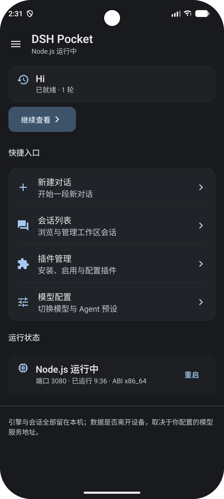
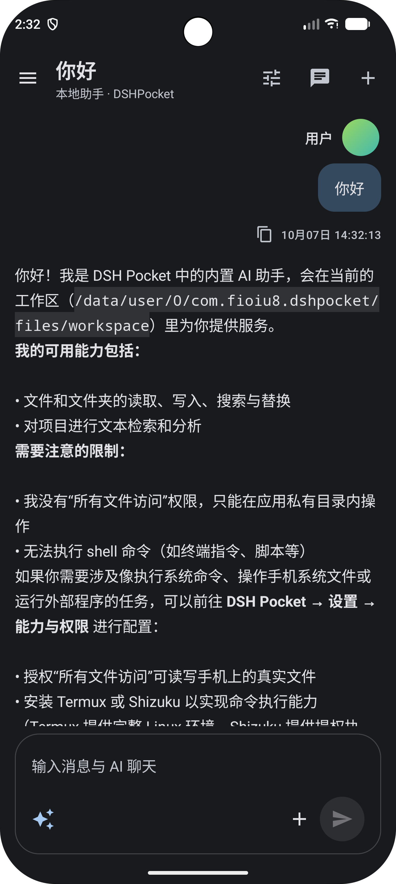
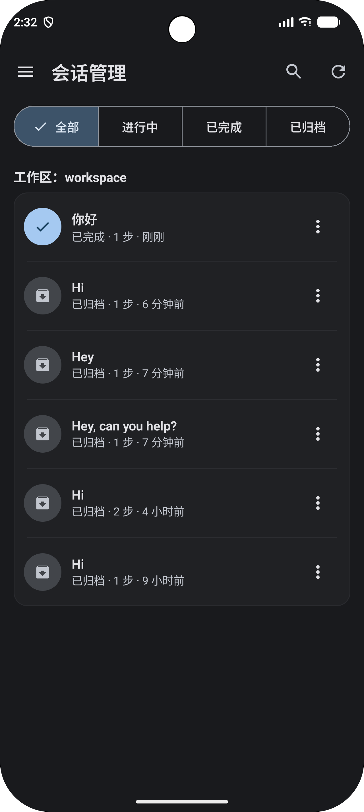
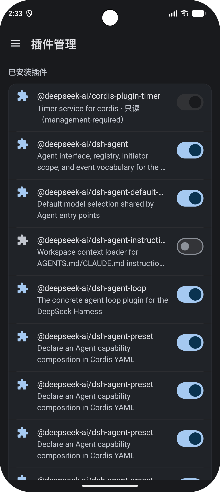

# DSH Pocket

**将 DeepSeek Harness 带到 Android 手机上的原生客户端。** DSH Pocket 会在设备上启动 Node.js 运行时和 DSH Web 服务，并提供原生 Compose 对话界面及管理页面。

[English](README.md)

> DSH Pocket 要求 Android 7.0（API 24）或更高版本。应用刻意使用 `targetSdk 28`，以便随包提供的运行时能够在应用私有目录中执行；当前面向侧载分发，不面向 Google Play 上架。

## 截图

| 首页 | 对话 |
| --- | --- |
|  |  |

| 会话 | 插件 |
| --- | --- |
|  |  |

## 功能

- 在 Android 本机运行 DSH Node.js Agent 引擎；引擎由前台服务管理。
- 可在原生对话界面与 DSH 官方 Web 界面之间切换；支持流式回复、浏览会话、归档与恢复。
- 配置模型服务商、查看已安装插件，并管理运行时及能力设置。
- AI 操作屏幕：读屏、点击、滑动、输入与截屏（截图直接随工具结果返回给模型，无需读取文件）；每次操作都有跑马灯提示，依次经过确定性规则、审查模型与原生确认弹窗的裁决，通知栏可随时紧急停止；缺权限时 AI 可弹窗引导你一键跳转授权页。
- 思维链悬浮窗：仅在你离开应用期间显示 AI 的思考过程，触摸可穿透，AI 操作屏幕时自动隐藏（AI 的截图与读屏都不会看到它）。
- 回合结束通知；退出后重新打开会回到上次的界面与对话。
- 可选授予所有文件访问权限，让 Agent 在共享存储的 `DSHPocket` 工作区内读写文件；默认使用应用私有工作区。

引擎及其网页界面通过本机回环地址 `127.0.0.1` 通信。发送给用户配置的模型服务商时，对话内容及相关上下文可能离开设备；AI 读屏与截图的内容同样会发送给所配置的服务商。Agent 可访问的文件范围取决于应用获得的 Android 权限和当前工作区。

## 主要依赖

| 组件 | 版本 | 许可证 | 来源 / 软件包仓库 |
| --- | --- | --- | --- |
| AndroidX Activity Compose | 1.13.0 | Apache-2.0 | [AndroidX](https://github.com/androidx/androidx)，Google Maven |
| Jetpack Compose UI、Material 3、图标 | Compose BOM 2026.02.01 | Apache-2.0 | [AndroidX](https://github.com/androidx/androidx)，Google Maven |
| AndroidX Core KTX | 1.19.1 | Apache-2.0 | [AndroidX](https://github.com/androidx/androidx)，Google Maven |
| AndroidX Lifecycle Runtime KTX | 2.11.0 | Apache-2.0 | [AndroidX](https://github.com/androidx/androidx)，Google Maven |
| AndroidX WebKit | 1.14.0 | Apache-2.0 | [AndroidX](https://github.com/androidx/androidx)，Google Maven |
| `@deepseek-ai/dsh` 及其 npm 依赖树 | CI：0.2.0-rc.2；发布版：由工作流选择 | MIT 及其他上游许可证 | [DeepSeek Harness](https://github.com/deepseek-ai/deepseek-harness)，[npm](https://www.npmjs.com/package/@deepseek-ai/dsh) |
| `@img/sharp-wasm32`（sharp 的 WebAssembly libvips） | 与随包 sharp 版本一致 | Apache-2.0 AND LGPL-3.0-or-later AND MIT | [sharp](https://github.com/lovell/sharp)，[npm](https://www.npmjs.com/package/@img/sharp-wasm32) |
| Node.js LTS（`nodejs-lts`） | 构建时从 Termux 索引解析 | MIT | [Termux 配方](https://github.com/termux/termux-packages/blob/master/packages/nodejs-lts/build.sh) |
| C++ 运行时（`libc++`）和 OpenSSL | 构建时从 Termux 索引解析 | NCSA；Apache-2.0 | [Termux 软件包](https://github.com/termux/termux-packages) |
| ICU（`libicu`）和 Mozilla CA 证书 | 构建时从 Termux 索引解析 | ICU 自定义许可证；MPL-2.0 | [Termux 软件包](https://github.com/termux/termux-packages)，[ICU 许可证](https://github.com/unicode-org/icu/blob/main/LICENSE) |
| `c-ares`、SQLite、zlib、`resolv-conf`、ripgrep、PCRE2 | 构建时从 Termux 索引解析 | MIT；Public Domain；ZLIB；BSD 3-Clause | [Termux 软件包](https://github.com/termux/termux-packages) |
| Kotlin Compose Gradle 插件 | 2.2.10 | Apache-2.0 | [Kotlin](https://github.com/JetBrains/kotlin)，Gradle Plugin Portal |

Android 库通过 Google Maven（配置中优先使用阿里云 Google Maven 镜像）和 Maven Central 获取。Gradle 插件还使用 Gradle Plugin Portal。Compose BOM 统一管理 Compose 组件版本。JUnit 和 `org.json` 仅用于测试，不属于应用运行时依赖。

运行时收集脚本会从 Termux 仓库获取 `nodejs-lts`、`libc++`、`openssl`、`c-ares`、`libicu`、`libsqlite`、`zlib`、`resolv-conf`、`ca-certificates`、`ripgrep` 和 `pcre2`。具体许可证标识及 npm 包版本见 [`THIRD-PARTY-NOTICES.md`](THIRD-PARTY-NOTICES.md)；软件包版本在构建时从 Termux 索引解析。上述上游组件保留各自许可证，不受本项目 MIT 许可证重新授权。

## 构建

### 环境要求

- Android SDK Platform 37，以及适用于当前 Android Gradle Plugin 的 Android Build Tools。
- JDK 25、Python 3.12、Node.js 22 和 npm。CI 使用上述版本。
- `x86_64` 或 `aarch64` 运行时构建主机目标；发布工作流目前构建 `arm64-v8a` APK。

### 准备运行时

`app/src/main/assets/runtime.zip` 由构建生成且不会提交到 Git。运行 Gradle 前需要先准备它。以下 PowerShell 命令会为 x86_64 准备运行时，并使用 push CI 当前固定的 DSH 版本：

```powershell
python tools/collect_runtime.py fetch --arch x86_64 --work .runtime-work
npm init -y --prefix .runtime-work/bundle
npm install --prefix .runtime-work/bundle --omit=dev --ignore-scripts --no-audit --no-fund @deepseek-ai/dsh@0.2.0-rc.2 @img/sharp-wasm32@0.35.5
python tools/collect_runtime.py pack --arch x86_64 --work .runtime-work --out .runtime-work/runtime-x86_64.zip
Copy-Item .runtime-work/runtime-x86_64.zip app/src/main/assets/runtime.zip
python tools/generate_third_party_notices.py app/src/main/assets/runtime.zip --output THIRD-PARTY-NOTICES.md
```

`@img/sharp-wasm32` 是运行时唯一的图像解码器：Android 没有 sharp 的原生预编译，sharp 的加载器会回退到这个 WebAssembly 构建。它的版本必须与 `@deepseek-ai/dsh` 解析出的 `sharp` 版本一致（`node -p "require('./.runtime-work/bundle/node_modules/sharp/package.json').version"`）。缺失时 `collect_runtime.py pack` 会直接报错终止。

如需本地构建 arm64，请将运行时命令中的 `x86_64` 改为 `aarch64`，并在下方构建命令中使用 `-PruntimeArch=aarch64`。如需与某个正式发布版本对应，应安装该发布选中的 DSH 版本并重新生成第三方清单。

### 构建 APK

本地 Debug 签名配置使用 Git 忽略的 `.keystore/debug.keystore`。在新检出目录中首次构建前，创建标准 Android Debug 密钥：

```powershell
New-Item -ItemType Directory -Force .keystore | Out-Null
keytool -genkeypair -v -keystore .keystore/debug.keystore -storepass android -alias androiddebugkey -keypass android -dname "CN=Android Debug,O=Android,C=US" -keyalg RSA -keysize 2048 -validity 10000
.\gradlew.bat --no-daemon testDebugUnitTest lintDebug assembleDebug -PruntimeArch=x86_64
```

Debug APK 输出到 `app/build/outputs/apk/debug/app-debug.apk`。正式 Release APK 由 GitHub Actions 草稿发布工作流构建，需要配置长期使用的签名密钥 Secrets，详见 [`.github/WORKFLOWS.md`](.github/WORKFLOWS.md)。

### 开发者测试

进行模型服务商联调时，可使用 [mock-model-provider](https://github.com/FIOIU8/mock-model-provider)。它提供兼容 OpenAI 协议的本地 API 和网页控制台，可在不调用真实模型的情况下测试普通及流式回复、工具调用、手动回复、延迟和错误模拟。

## 许可证

本项目自有源代码和资源采用 MIT 许可证，详见 [`LICENSE`](LICENSE)。APK 中打包的第三方组件仍适用各自许可证和声明；运行时包含 MPL-2.0 组件，其 WebAssembly 图像解码器（`@img/sharp-wasm32`）包含 LGPL-3.0-or-later 组件。运行时归档会保留上游包提供的许可证文件；当前清单及已发现的打包问题见 [`THIRD-PARTY-NOTICES.md`](THIRD-PARTY-NOTICES.md)。项目 MIT 许可证不会替代或重新授权第三方组件。DSH 名称及其他第三方商标也不由本项目许可证授予。
